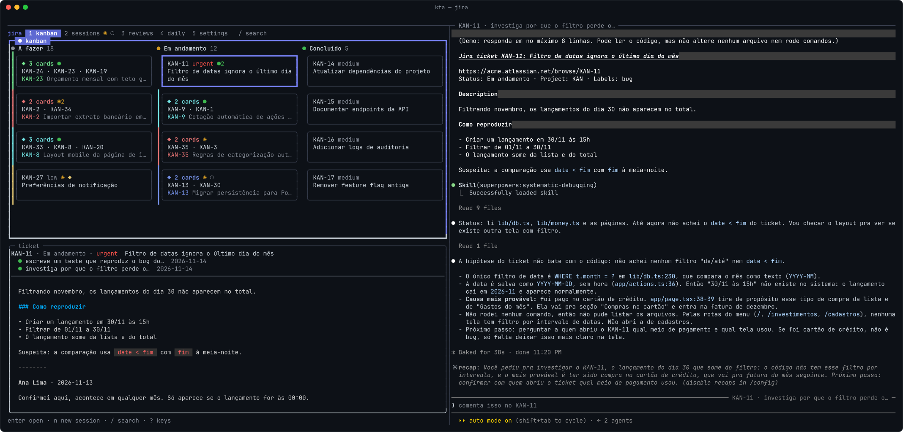
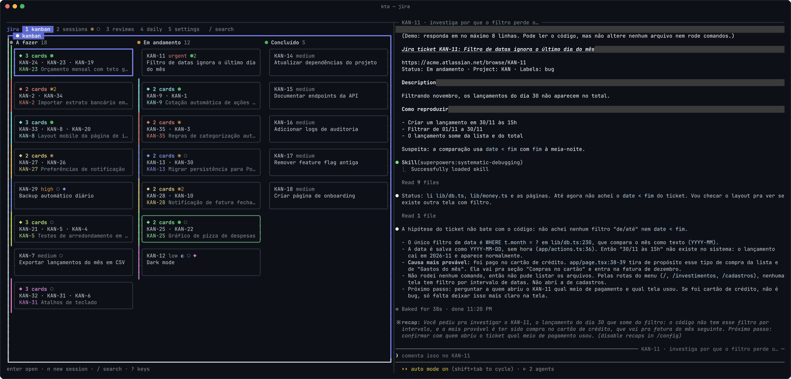
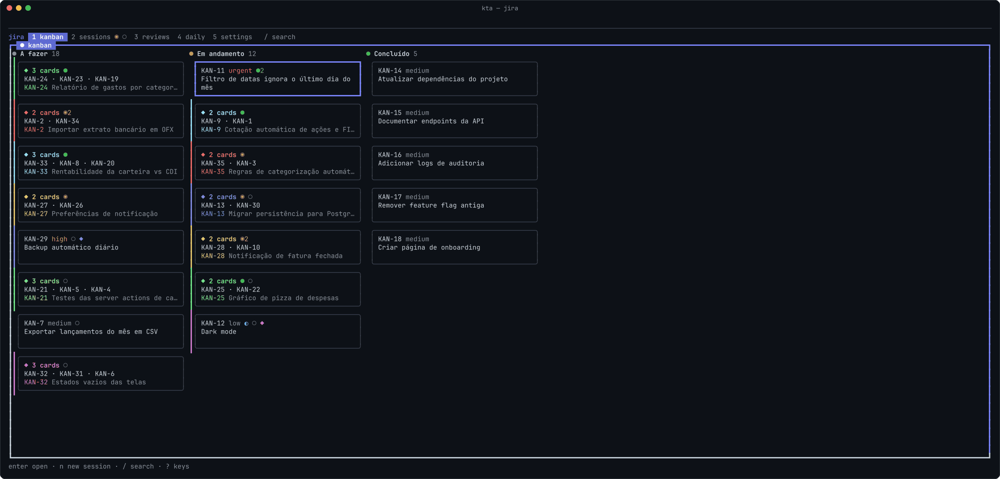
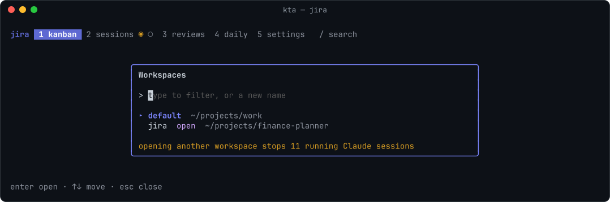

# kta



**Your tickets in a terminal kanban, with Claude Code sessions right next to them.**

Pick a card, tell Claude what to do, and follow every session from one screen. A dot on each card shows which ones are working, waiting for you or stopped. Works with Linear, Jira and Trello.

## What you need

- [tmux](https://github.com/tmux/tmux/wiki/Installing) and [Go](https://go.dev/dl/)
- [Claude Code](https://docs.anthropic.com/en/docs/claude-code), logged in
- An API key from your kanban: Linear, Jira or Trello ([how to get one](docs/how-to/api-keys.md))

On macOS that's `brew install tmux go`. On Linux, install tmux from your package manager and Go from [go.dev/dl](https://go.dev/dl/).

## Run it

```sh
git clone https://github.com/berstanislaw/kta.git
cd kta
./kta
```

The first time, it asks where your tickets are, your API key and which folder Claude should work in. Then the board opens. Next time, just run `./kta` again.

## Using it



Move with the arrows (or `hjkl`), `enter` opens a ticket and `n` starts a Claude session for it. `?` shows every key of the screen you're on, and `q` quits. Sessions are saved, so `enter` brings a stopped one back.

| dot | |
| --- | --- |
| ● green | Claude is working |
| ◉ orange | Claude is waiting for you |
| ◐ blue | Claude is done, but background work is still running |
| ○ grey | stopped |

### Sessions



Press `n` on a ticket and write what you want. Claude starts with the whole ticket: title, description and comments. A ticket can have as many sessions as you want, and `enter` shows any of them on the right.

### Several tickets at once

Mark cards with `g` and press `n`: one session works on all of them, and the cards become a colored group. `z` folds a group into one card, `Z` folds them all. To change a group, just ask its session, like "add KAN-12 to this" or "take KAN-9 out".

### Workspaces



`alt+w` opens the workspace picker. A workspace is one kanban account plus one folder, say Jira for work and Linear for a side project. Type a new name to create one. Switching stops the Claude sessions of the current workspace, and they resume when you come back.

### Tabs

| tab | |
| --- | --- |
| `1` kanban | your tickets |
| `2` sessions | Claude sessions that don't belong to a ticket |
| `3` reviews | your pull requests and your team's, with Claude reviewing them (needs the [GitHub CLI](https://cli.github.com/)) |
| `4` daily | a short summary of what you did, for stand-ups |
| `5` settings | which columns and tickets show up, language, notifications, tabs |

### Keys

| key | does |
| --- | --- |
| arrows / `hjkl` | move around |
| `enter` | open a ticket, or show a session on the right |
| `n` | new Claude session (`ctrl+s` starts it) |
| `g` | mark cards to work on together |
| `z` / `Z` | fold or unfold a group / every group |
| `p` / `o` | open the PRs / the ticket in the browser |
| `/` | search |
| `r` | reload the board, or try again when the tracker didn't respond |
| `tab` / `esc` | go to the ticket panel / back |
| `x x` / `d d` | stop / remove a session |
| `alt+1` … `alt+5` | switch tabs, also from inside Claude |
| `alt+←` / `alt+→` | move between the board and Claude |
| `alt+w` | workspaces |
| `?` | every key |
| `q` | quit |

## macOS

The `alt+…` shortcuts need the Option key to work as Alt:

| terminal | setting |
| --- | --- |
| iTerm2 | Settings → Profiles → Keys → Left Option key: `Esc+` |
| Terminal.app | Settings → Profiles → Keyboard → Use Option as Meta key |
| Ghostty | `macos-option-as-alt = true` |
| Alacritty | `option_as_alt = "Both"` under `[window]` |

Without it, `1` … `5` still switch tabs and you can click between the panes.

## How it works

For the curious, or when something looks off.

- **Its own tmux.** The board runs in a separate tmux server (`tmux -L kta`), so your own tmux setup is never touched. Each Claude session is a tmux window, and the one you're looking at sits next to the board.
- **Updating.** `./kta` builds itself the first time and rebuilds whenever the code changes, so updating is `git pull` and `./kta`. Running it while it's open re-attaches to the same board.
- **Config.** The setup saves to `~/.config/kta/env`, readable only by you. `./kta setup` asks again, keeping the secrets you leave empty. By hand, it's either of these:

  ```sh
  TRACKER='linear'
  LINEAR_API_KEY='lin_api_…'
  WORKSPACE_DIR='~/projects/my-repo'
  ```

  ```sh
  TRACKER='jira'
  JIRA_URL='https://acme.atlassian.net'
  JIRA_EMAIL='you@acme.com'
  JIRA_API_TOKEN='…'
  WORKSPACE_DIR='~/projects/my-repo'
  ```

  ```sh
  TRACKER='trello'
  TRELLO_API_KEY='…'
  TRELLO_TOKEN='…'
  WORKSPACE_DIR='~/projects/my-repo'
  ```

  How to get each key is in [docs/how-to/api-keys.md](docs/how-to/api-keys.md).
- **Workspaces.** The default one lives in `~/.config/kta/`, the others in `~/.config/kta/workspaces/<name>/`, each with its own key, folder, sessions, groups and settings. `./kta <name>` opens one from the terminal, and `./kta default` goes back.
- **What Claude gets.** Every session started by the board starts in `WORKSPACE_DIR`, with the workspace's credentials as environment variables and a note on how to use your tracker's API. "Move this ticket to In Review" works with no extra setup. It's also told where the transcripts of the ticket's older sessions are, so it can catch up.
- **Statuses.** They come from Claude Code hooks, passed with `--settings` when a session starts. The hooks call `kta hook`, which writes the status and sends the desktop notification (on Linux that needs `notify-send`).
- **Board.** You see every ticket assigned to you, in every status. Settings can add the ones you created or follow, and hide columns. It refreshes every 30 seconds. When a ticket is finished or canceled, the board forgets its stopped sessions.
- **Trello.** A ticket is a card you're a member of, its key is the card's short link (the `aBcD1234` in `trello.com/c/aBcD1234`) and its status is its list. A card counts as finished when it's archived or sits in a list called something like Done.
- **Groups.** A group has an id, lives in `groups.json` and keeps its tickets until they're all finished. Sessions manage it with these commands, which kta tells them about:

  | command | does |
  | --- | --- |
  | `kta group` | lists this session's tickets |
  | `kta group add KAN-123 …` | adds tickets, moving them out of other groups |
  | `kta group remove KAN-123 …` | takes tickets out |
  | `kta groups` | lists every group (add `--group <id>` to change another one) |
- **PRs on cards.** On Linear, they come from its GitHub integration and show up tagged by repo, like `A#1782`.
- **Reviews.** On a team PR, `r` asks Claude for a review in the background (`claude -p` with read-only tools). Go through the threads with `←` / `→`. `a` discusses one, `c` rewrites its comment, `x x` drops it, and `s s` sends them all to GitHub as a draft review only you can see.
- **Daily.** It reads your Claude sessions since the last working day and asks Claude Haiku for one bullet per subject, in the language picked in settings.
- **Code.** `cmd/kta` is the entry point. `internal/` has one package per concern: `config`, `tracker` (one file per tracker: Linear, Jira and Trello), `store` (sessions, groups, settings), `tmux`, `claude` (launching sessions, hooks, prompts), `github`, `review`, `daily` and `ui` (the board).
- **Tests.** Run `go test ./...`. They never touch your real config. To build by hand, use `go build -o bin/kta ./cmd/kta`.

## TODO

- PRs on Jira and Trello cards (Jira only exposes them through an undocumented API)
- Jira Server / Data Center
- More trackers, like GitHub Projects. A tracker is one file in `internal/tracker`: a `Kind` (name, setup fields, API hint) and a client with the five methods of `backend` in `tracker.go`, plus one line in `All`. Look at `trello.go` for a small one.

## Troubleshooting

- **Alt shortcuts don't work**: on macOS, see above.
- **"didn't respond"**: the tracker was slow for a moment. Press `r`.
- **The layout got weird**: run `tmux -L kta kill-server` and `./kta` again. Your sessions are still there.
- **No notifications on Linux**: install `notify-send` (package `libnotify`).
- **Wrong key or folder**: `./kta setup`.
